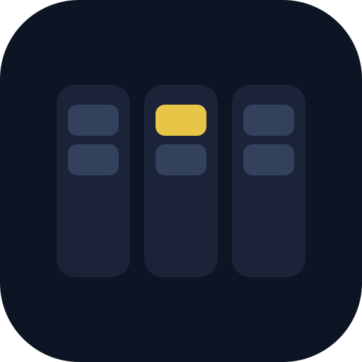
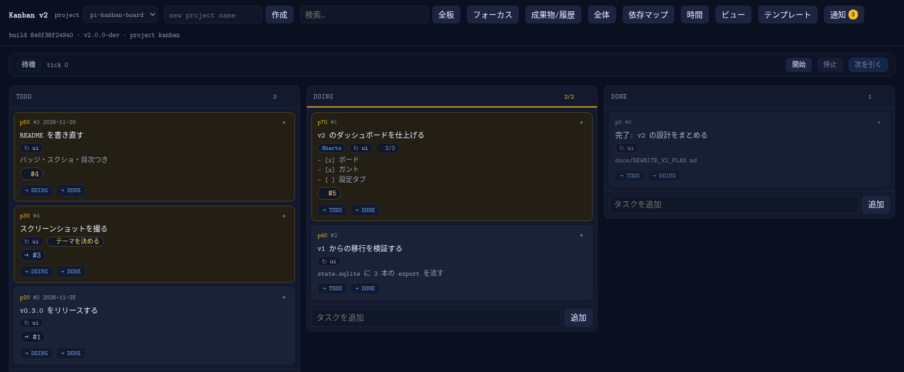
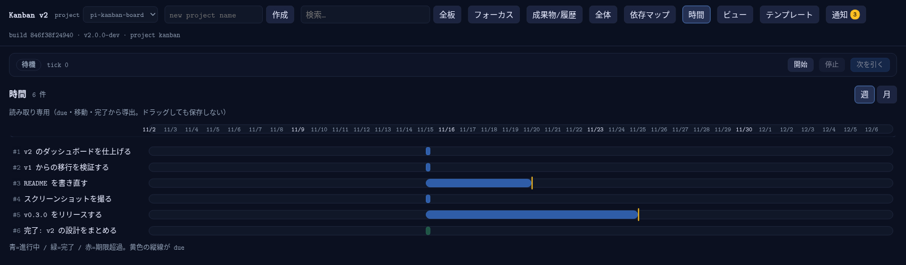
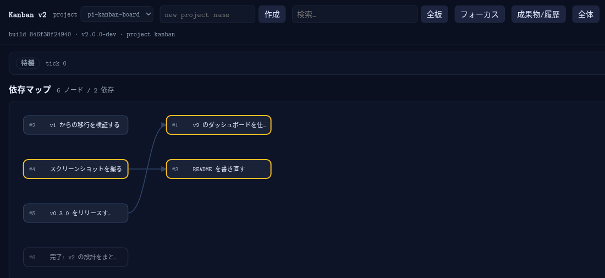

<div align="center">



# pi-kanban-board

**A kanban board the agent runs itself, for [pi](https://github.com/earendil-works/pi).**

One board per project. You and the agent read the same board and move in the same order.

[日本語](./README.md) · **English**

[](https://github.com/solidlime/pi-kanban-board/releases)
[](LICENSE)
[](https://nodejs.org)
[](https://github.com/earendil-works/pi)

[Install](#install) ·
[Usage](#usage) ·
[Dashboard](#dashboard) ·
[Configuration](#configuration) ·
[Where data lives](#where-data-lives)

</div>



## Why a board

Long sessions lose the thread. The goal drifts, earlier decisions fall out, settled arguments come back.

The board fixes that by putting the thread where both the human and the model read it. The agent moves cards with the `kanban` tool, and the board state is handed back into the conversation every turn. A board belongs to a **project** — the git root of the cwd — so every session opened in that repo reads the same board.

## What you get

| Feature | Detail |
|---|---|
| **Boards** | One per project. A read-only `GLOBAL` aggregation sits on the same screen |
| **Cards** | Priority, owner, labels, due date, blocked reason, dependencies, attachments |
| **Views** | A filter saved under a name, switched with one click |
| **Templates** | Create a card from a shape you write often |
| **Time** | Gantt derived from due dates, moves and completions (read-only) |
| **Dependencies** | A graph of "B can't start until A is done" |
| **Deliverables** | Output worth showing (screenshots, reports, videos) is not a card. It gets its own strip |
| **Loop** | A state machine that hands out the next card. Start, stop, pull next |
| **Digest** | One page of Markdown: what finished, what shipped, which commits |
| **Notifications** | Split into danger, warning and info. `KANBAN_NOTIFY_SINK` mirrors them to a file |

## Install

```bash
pi install git:github.com/solidlime/pi-kanban-board
```

Installs straight from this repo. It is not on npm yet.

To try it once without touching your settings:

```bash
pi -e git:github.com/solidlime/pi-kanban-board
```

### First start

The server initializes a home that is missing or empty, on boot. **In practice you do nothing.**

To look before it happens, you can run the same step by hand:

```bash
node src/cli/init.ts --inspect   # show what would be created (writes nothing)
```

`--inspect` writes nothing and stops after printing the plan (exit 2).

## Usage

### From the agent

Models call two tools directly.

**`kanban`** — the board their own work sits on.

| action | What it does |
|---|---|
| `list` | Read the board |
| `add` | Create a card |
| `move` | Move it to a column (`todo` / `doing` / `done`) |
| `edit` | Rewrite text, priority, labels, owner, due date, blocked reason |
| `remove` | Delete the card |
| `check` | Self-check of the DB, schema and boards |
| `resume` | Clear the loop's stop (state only) |
| `url` | Token-carrying dashboard URL |
| `img` | Copy a local image into `media/` and attach it |
| `ref` | Attach a local path as a reference (not copied) |

`scope` picks the board. The default is `project` — the repo of the cwd. `global` is a read-only aggregate over every project; writes are refused there. `project=<slug>` names another board.

**`deliverable`** — output you want shown. Not a card.

Screenshots, reports, videos. Actions: `add` / `list` / `edit` / `remove` / `img` / `ref`. It has its own id space, so `deliverable #3` and `card #3` are different things.

### Slash commands

| Command | What it does |
|---|---|
| `/kanban <task>` | Add to TODO |
| `/kanban add <task>` | Same (an empty card is never created) |
| `/kanban list` | Show this project's board |
| `/kanban move <id> <col>` | Move to a column (`todo` / `doing` / `done`) |
| `/kanban remove <id>` | Delete the card |
| `/kanban check` | Self-check of the DB, schema and boards |
| `/kanban digest [--since 7d]` | Markdown of completions, deliverables and commits |
| `/kanban url` | Dashboard URL |
| `/kanban resume` | Set the loop to running (state only) |

## Dashboard

A pi session starts an HTTP server on `0.0.0.0:8789`. Open it with `/kanban url`, or point a browser at `http://<host>:8789/`. It is the only screen, and there is no daemon: the board is alive only while pi runs.

### Board

Three columns (TODO / DOING / DONE). Cards carry priority, owner, labels, due date, blocked reason, dependencies and attachments. Columns take a WIP limit (unlimited by default; the count turns red past it).

- Double-click opens the detail: body, acceptance criteria, dependencies, attachments, history
- Move a card with its `→ DOING` button, or the target select in the detail
- `✎` edits the title in place; a column's `⚙` edits its name and WIP limit
- Search runs across body, `#id`, project, owner, blocked reason and labels
- Attachments are picked in the detail view (png / jpeg / gif / webp)

### Time



Bars are derived from due dates, moves and completions. **Read-only** — dragging saves nothing. Blue is in progress, green is done, the yellow vertical line is the due date. Switch between weeks and months.

### Dependency map



"B can't start until A is done", as a graph. Closed cards fade, cycles are detected and marked. Two kinds: `blocks` and `relates`.

### The rest of the screen

- **Deliverables / History** — the deliverable strip and a timeline of card moves
- **All boards** — search across every project
- **Focus** — collects only what you can start (not done, not blocked) into "Do now"
- **Views / Templates** — saved filters and card shapes
- **Notifications** — one list split into danger, warning and info
- **Loop** — start, stop, pull next. v2 ships no executor: the state machine hands out the next card, and the agent or you run it

## Configuration

Everything is an environment variable. The defaults work, so usually you set none.

| Variable | Default | Meaning |
|---|---|---|
| `KANBAN_PORT` | `8789` | HTTP port |
| `KANBAN_HOST` | `0.0.0.0` | Only used in the URL shown when the port was taken and this process rode along. **Not the bind address** — bind is always `0.0.0.0` |
| `KANBAN_HOME` | `~/.pi/kanban` | Swap the state directory (for trying it out; init is separate) |
| `KANBAN_AUTH` | off | `on` makes the token required (below) |
| `KANBAN_LOOP_MS` | `15000` | Heartbeat of the cross-board loop. `0` stops it |
| `KANBAN_NOTIFY_SINK` | off | `file:<path>` mirrors notifications to a file |

## Security

Auth is off by default. A board one person uses on a private network does not justify putting a 64-character token in every URL.

With `KANBAN_AUTH=on`, every route including the GUI itself needs the token. Init generates it at `~/.pi/kanban/token` (`0600`). Three ways to carry it:

- Cookie `kb_auth` (`HttpOnly`, 30 days)
- `Authorization: Bearer <token>`
- `GET /?token=<token>` — **once only**. It becomes a cookie and is stripped from the Referer

Even so, do not forward 8789 to the internet.

## Where data lives

```
~/.pi/kanban/
├── state.sqlite       boards, cards, deliverables, dependencies, history (WAL)
├── state.sqlite-wal   write-ahead log
├── state.sqlite-shm   shared memory
├── media/att/         attachments (content-addressed)
├── token              auth token (0600)
└── servers.json       running servers
```

## Requirements

- Node.js 22.5 or newer (it uses type stripping)
- pi
- No build step — the extension reads `src/` directly. The dashboard is served from `web/dist/`

## Development

```bash
npm run build:v2        # web/src → web/dist
npm run serve:v2        # run the built server on its own
npm run dev:v2          # seed a throwaway home with demo data and start
npm run test:v2         # typecheck + unit / integration / e2e
```

`npm run dev:v2` never touches `~/.pi/kanban`. It is the fastest loop when working on the UI.

## License

MIT
