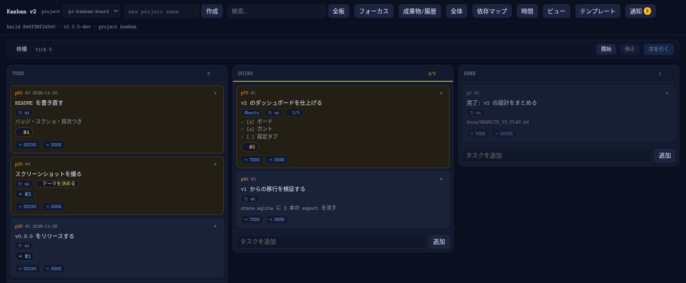
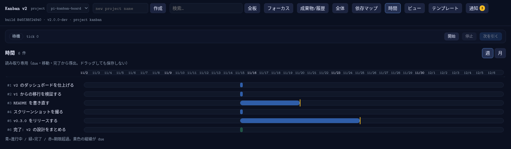
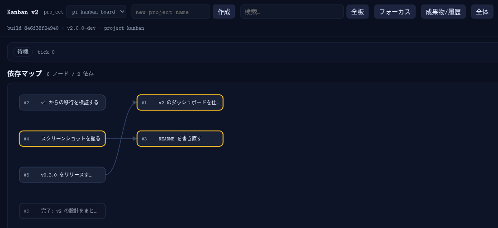

<div align="center">


# pi-kanban-board

**エージェントが自分で動かす、[pi](https://github.com/earendil-works/pi) 用のカンバンボード。**

プロジェクトごとに1枚の板。あなたとエージェントが同じ板を見て、同じ順番で仕事を進める。

**日本語** · [English](./README.en.md)

[](https://github.com/solidlime/pi-kanban-board/releases)
[](LICENSE)
[](https://nodejs.org)
[](https://github.com/earendil-works/pi)

[インストール](#インストール) ·
[使い方](#使い方) ·
[ダッシュボード](#ダッシュボード) ·
[設定](#設定) ·
[データの置き場所](#データの置き場所)

</div>



## なぜ板なのか

長いセッションは糸が切れる。目的がずれ、前の決定を忘れ、決着済みの話を蒸し返す。

板はそれを、人間とモデルの両方が読む場所に置いて直す。エージェントは `kanban` ツールでカードを動かし、ボードの状態は毎ターン会話に差し戻される。板は**プロジェクト**（cwd の git ルート）に属するから、そのリポジトリで開いたセッションはどれも同じ板を見る。

## できること

| 機能 | 内容 |
|---|---|
| **板** | プロジェクトごとに1枚。全プロジェクトを束ねる読み取り専用の `GLOBAL` も同じ画面に並ぶ |
| **カード** | 優先度・担当・ラベル・期限・ブロック理由・依存関係・添付ファイル |
| **ビュー** | 絞り込み条件に名前を付けて保存。ワンクリックで切り替え |
| **テンプレート** | よく書くカードの雛形から1手で作成 |
| **時間** | 期限・移動・完了から導出するガント（読み取り専用） |
| **依存マップ** | 「A が終わるまで B はできない」をグラフで表示 |
| **成果物** | 見せたい出力（スクショ・レポート・動画）はカードにしない。専用の帯に置く |
| **ループ** | 次にやるカードを出す状態機械。開始・停止・次を引く |
| **ダイジェスト** | 期間中の完了・成果物・コミットを Markdown 1枚にまとめる |
| **通知** | 危険 / 警告 / 情報に分かれた通知。`KANBAN_NOTIFY_SINK` でファイルにも流せる |

## インストール

```bash
pi install git:github.com/solidlime/pi-kanban-board
```

このリポジトリから直接入れる。npm にはまだ公開していない。

設定を触らずに一度だけ試すなら:

```bash
pi -e git:github.com/solidlime/pi-kanban-board
```

### 初回起動

ホームが無い・空のときは、サーバーが起動時に自分で初期化する。**普通は何もしなくてよい。**

先に中身を確認したいときは、手で回せる:

```bash
node src/cli/init.ts --inspect   # 何が作られるかを見るだけ（書かない）
```

`--inspect` は何も書かずに、作られる予定を出して終わる（exit 2）。

## 使い方

### エージェントから

モデルは2つのツールを直接叩く。

**`kanban`** — 自分の仕事を載せる板。

| action | 何をするか |
|---|---|
| `list` | 板を読む |
| `add` | カードを作る |
| `move` | 列を移す（`todo` / `doing` / `done`） |
| `edit` | 文言・優先度・ラベル・担当・期限・ブロック理由を書き換える |
| `remove` | カードを消す |
| `check` | DB・スキーマ・板の自己診断 |
| `resume` | ループの停止を解除する（状態だけ） |
| `url` | トークン付きのダッシュボード URL |
| `img` | ローカルの画像を `media/` に取り込んで添付する |
| `ref` | ローカルのパスを参照として添付する（コピーしない） |

`scope` で板を選ぶ。既定は `project`（cwd のリポジトリ）。`global` は全プロジェクトの読み取り専用の集約で、書き込みは拒否される。`project=<slug>` で別の板を明示できる。

**`deliverable`** — 見せたい出力。カードにはしない。

スクリーンショット、レポート、動画。`add` / `list` / `edit` / `remove` / `img` / `ref` を持つ。カードと ID 空間が別なので、`deliverable #3` と `card #3` は別物。

### スラッシュコマンド

| コマンド | 何をするか |
|---|---|
| `/kanban <タスク内容>` | TODO に追加 |
| `/kanban add <タスク内容>` | 同じ（空のカードは作らない） |
| `/kanban list` | このプロジェクトの板を表示 |
| `/kanban move <id> <col>` | 列を移す（`todo` / `doing` / `done`） |
| `/kanban remove <id>` | カードを削除 |
| `/kanban check` | DB / スキーマ / 板の自己診断 |
| `/kanban digest [--since 7d]` | 期間の完了・成果物・コミットを Markdown に |
| `/kanban url` | ダッシュボードの URL |
| `/kanban resume` | ループを running にする（状態だけ） |

## ダッシュボード

pi のセッションが始まると、HTTP サーバーが `0.0.0.0:8789` で立つ。`/kanban url` で開くか、ブラウザで `http://<host>:8789/` を開く。これが唯一の画面で、デーモンは無い — pi が動いている間だけ板が生きている。

### ボード

3列（TODO / DOING / DONE）にカードが並ぶ。カードには優先度・担当・ラベル・期限・ブロック理由・依存・添付が付く。列には WIP 上限を置ける（既定は無制限、超えると件数が赤くなる）。

- ダブルクリックで詳細を開く。本文・受け入れ条件・依存・添付・履歴はここで扱う
- 列の移動はカードの `→ DOING` ボタンか、詳細の移動先セレクト
- `✎` でタイトル、列の `⚙` で列名と WIP 上限をその場で編集する
- 検索ボックスは本文・`#番号`・label・project・sid・session・commit・blocked を横断する
- 添付は詳細画面のファイル選択（png / jpeg / gif / webp）

### 時間



期限・移動・完了から期間を導出して帯で見せる。**読み取り専用** — ドラッグしても保存しない。青が進行中、緑が完了、黄色い縦線が期限。週と月を切り替えられる。

### 依存マップ



「A が終わるまで B はできない」をグラフで見る。閉じたカードは淡く、循環は検出して印を付ける。`blocks` と `relates` の2種類。

### その他の面

- **成果物 / 履歴** — 成果物の帯と、カードの移動履歴（タイムライン）
- **全板** — 全プロジェクトをまたいで検索する
- **フォーカス** — 着手できるカード（未完了・未ブロック）だけを「いまやる」に集める
- **ビュー / テンプレート** — 保存した絞り込みと雛形
- **通知** — 危険 / 警告 / 情報に分かれた一覧
- **ループ** — 開始 / 停止 / 次を引く。v2 は実行器を積まない。状態機械が「次にやるカード」を出すので、実行するのはエージェントかあなた

## 設定

すべて環境変数。既定値のまま動くので、通常は何も要らない。

| 変数 | 既定 | 意味 |
|---|---|---|
| `KANBAN_PORT` | `8789` | HTTP サーバーのポート |
| `KANBAN_HOST` | `0.0.0.0` | ポートが埋まっていて相乗りしたときの表示 URL。**bind 先ではない**（bind は常に `0.0.0.0`） |
| `KANBAN_HOME` | `~/.pi/kanban` | 状態ディレクトリを差し替える（試用向け。初期化は別途） |
| `KANBAN_AUTH` | off | `on` でトークン必須にする（下記） |
| `KANBAN_LOOP_MS` | `15000` | 横断ループの心拍。`0` で止める |
| `KANBAN_NOTIFY_SINK` | off | `file:<path>` で通知をファイルに流す |

## セキュリティ

既定では認証を掛けない。私的なネットワークで1人が使う板に、URL に 64 桁のトークンを載せる手間の方が高くつくから。

`KANBAN_AUTH=on` にすると、GUI の本体まで含めて全ルートがトークン必須になる。トークンは初回初期化で `~/.pi/kanban/token`（`0600`）に生成される。運び方は3つ:

- Cookie `kb_auth`（`HttpOnly`、30日）
- `Authorization: Bearer <token>`
- `GET /?token=<token>` — **この1回だけ**。Cookie に変えて、Referer からも外す

それでもインターネットに 8789 を転送しないこと。

## データの置き場所

```
~/.pi/kanban/
├── state.sqlite       板・カード・成果物・依存・履歴（WAL）
├── state.sqlite-wal   書き込み途中のログ
├── state.sqlite-shm   共有メモリ
├── media/att/         添付ファイル（内容アドレス）
├── token              認証トークン（0600）
└── servers.json       起動中のサーバー
```

## 動作環境

- Node.js 22.5 以上（型ストリップを使う）
- pi 本体
- ビルド不要 — 拡張は `src/` を直接読む。ダッシュボードの配信物は `web/dist/`

## 開発

```bash
npm run build:v2        # web/src → web/dist
npm run serve:v2        # ビルド済みのサーバーを単体で起動
npm run dev:v2          # 使い捨てのホームに全機能のデモを蒔いて起動
npm run test:v2         # 型検査 + unit / integration / e2e
```

`npm run dev:v2` は `~/.pi/kanban` に一切触らない。UI をいじるときはこれが一番速い。

## ライセンス

MIT
